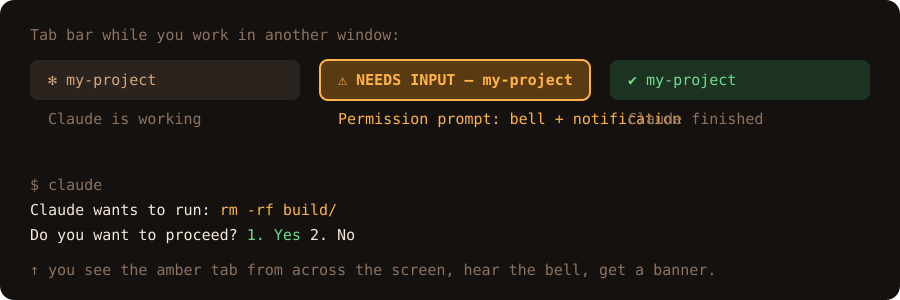

<p align="center">
  
</p>

<p align="center">
  <a href="https://github.com/SiriWastaken/claude-needs-input/actions/workflows/ci.yml"></a>
  <a href="https://github.com/SiriWastaken/claude-needs-input/releases/latest"></a>
  <a href="LICENSE"></a>
  
  <a href="https://github.com/SiriWastaken/claude-needs-input/stargazers"></a>
</p>

<p align="center"><b>Stop babysitting your terminal.</b> A Claude Code plugin that makes it obvious the moment Claude is waiting on you.</p>

<p align="center">
  
</p>

## Why

Claude Code asks permission, asks questions, and goes idle, usually while you're in another window. In a busy terminal that prompt is easy to miss, and Claude sits blocked. This plugin shouts for you.

| When | You get |
| --- | --- |
| Permission prompt, question, or idle | Tab title `⚠ NEEDS INPUT — <project>`, a bell, and a desktop notification with Claude's message |
| You respond | Title returns to `✻ <project>` |
| Claude finishes | Title shows `✔ <project>` |

## Install

```
/plugin marketplace add SiriWastaken/claude-needs-input
/plugin install needs-input@needs-input
```

Restart Claude Code. Requires `bash` and [`jq`](https://jqlang.github.io/jq/); without `jq` the plugin silently does nothing.

## Features

- **Zero daemon.** Four hooks and one ~45-line shell script.
- **Per-terminal.** Titles are set per tab, so parallel sessions stay distinguishable.
- **Right escape for your terminal.** iTerm2, WezTerm, Windows Terminal, Kitty, Ghostty, Warp and more, auto-detected.
- **Safe.** Message text is stripped of control characters before touching your terminal.
- **Tested.** Shell unit tests and shellcheck run in CI.

## Configuration

Set in your shell or in Claude Code `env` settings:

| Variable | Default | Effect |
| --- | --- | --- |
| `CNI_BELL` | `1` | `0` disables the bell |
| `CNI_NOTIFY` | `1` | `0` disables the desktop notification |
| `CNI_TITLE_PREFIX` | `⚠ NEEDS INPUT` | Text shown in the title while waiting |
| `CNI_NOTIFY_STYLE` | auto | Force the notification escape: `777`, `9` or `99` |

## Docs

- [How it works](docs/how-it-works.md)
- [Terminal support](docs/terminals.md) (incl. tmux and SSH)
- [Troubleshooting](docs/troubleshooting.md)
- [Changelog](CHANGELOG.md) · [Contributing](CONTRIBUTING.md) · [Security](SECURITY.md)

## Uninstall

```
/plugin uninstall needs-input@needs-input
```

## Contributing

PRs welcome, especially "works in terminal X" reports. See [CONTRIBUTING.md](CONTRIBUTING.md).

```
bash tests/cni.test.sh          # unit tests
claude plugin validate .        # manifest check
claude --plugin-dir .           # try it live
```

## License

[MIT](LICENSE)
